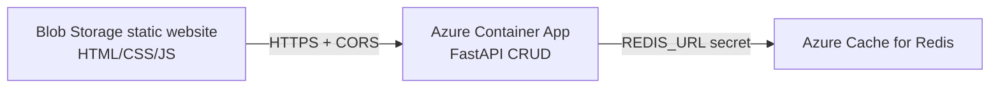

# TaskBoard · Cloud Seminar Assignment

一个简洁的 Python 三服务云应用：静态前端创建任务，FastAPI 容器提供 CRUD，Redis 保存任务数据。它对应作业第 45–47 页的核心评分项，并附带 Terraform 和 CI 加分项配置。



## 目录

- `frontend/`：独立静态网站；`config.js` 保存 API 基地址，不包含密钥。
- `api/`：FastAPI CRUD API、Dockerfile、pytest 测试。
- `docker-compose.yml`：本地一次启动 Redis、API、前端三个服务。
- `infra/`：Azure Container Apps + Blob static website + Azure Cache for Redis 的 Terraform。
- `scripts/`：将云端 API URL 写入静态前端并上传到 Blob Storage。
- `.github/workflows/ci.yml`：测试、编译、构建两个镜像、检查 Terraform 格式。
- `VIDEO_SCRIPT.md`：2–3 分钟视频逐句脚本。
- `SUBMISSION_CHECKLIST.md`：截图、视频和提交前检查清单。

## 1. 本地运行

需要 Docker Compose。macOS 可以使用 Docker Desktop，或者使用本次已安装的 Docker CLI + Colima：

```bash
brew install docker docker-compose docker-buildx colima
colima start
```

启动 Docker 引擎后运行：

```bash
docker compose up --build
```

浏览器打开 <http://localhost:8080>。在页面添加、勾选、删除任务；前端请求 `http://localhost:8000`，API 将数据写入 Redis。也可打开 <http://localhost:8000/docs> 查看 Swagger。

停止并清除本地 Redis 数据：

```bash
docker compose down -v
```

## 2. 推送到自己的 Git 仓库

在 GitHub/GitLab 新建一个空仓库后执行：

```bash
git remote add origin <YOUR_REPO_URL>
git push -u origin main
```

提交邮件中的 repo 链接填写该仓库的公开 URL。

## 2. 直接运行 API 测试

```bash
python3 -m venv .venv
source .venv/bin/activate
python -m pip install -r api/requirements-dev.txt
PYTHONPATH=api pytest -q api/tests
```

## 3. Azure 部署（作业要求的云端路径）

需要 Azure CLI、Terraform、一个公开可拉取的 API 镜像仓库（例如 GHCR）。先构建并推送镜像：

```bash
docker build -t ghcr.io/<你的账号>/taskboard-api:latest api
docker push ghcr.io/<你的账号>/taskboard-api:latest
```

准备 Terraform 变量并部署：

```bash
cd infra
cp terraform.tfvars.example terraform.tfvars
# 编辑 terraform.tfvars：subscription_id、api_image、唯一的 storage_account_name
terraform init
terraform fmt -recursive
terraform validate
terraform apply
```

Terraform 会创建并互联三个云服务：

1. Blob Storage 静态网站托管前端；
2. Container App 对外提供 FastAPI API；
3. Azure Cache for Redis 作为实际数据层，连接串只通过 Container App secret 注入到 `REDIS_URL`。

`config.js` 会由 Terraform 使用 Container App URL 生成。部署完成后运行：

```bash
terraform output frontend_url
```

打开该 URL 做端到端演示。录制视频和保存截图后按作业要求删除资源：

```bash
az group delete --name "$(terraform output -raw resource_group_name)" --yes
```

## 作业交付对应关系

| 作业要求 | 本项目对应内容 |
|---|---|
| 自己的 repo + Dockerfiles | `api/Dockerfile`、`frontend/Dockerfile` |
| 3-service app | Blob static website + Container App + Redis |
| API 必须真实使用托管资源 | `api/app/main.py` 使用 Redis 读写任务 |
| 无 secret 写入代码 | `REDIS_URL` 由环境变量/Container App secret 提供 |
| 端到端视频 | 参照 `VIDEO_SCRIPT.md` 录制公开 URL、云控制台、问题解决和生产改进 |
| 加分：CI | `.github/workflows/ci.yml` |
| 加分：Terraform | `infra/` |

当前目录已经是可运行的作业成品；真正的公开 URL、云控制台截图和视频链接需要在你的 Azure/GitHub 账号中部署和录制后补入提交邮件。
